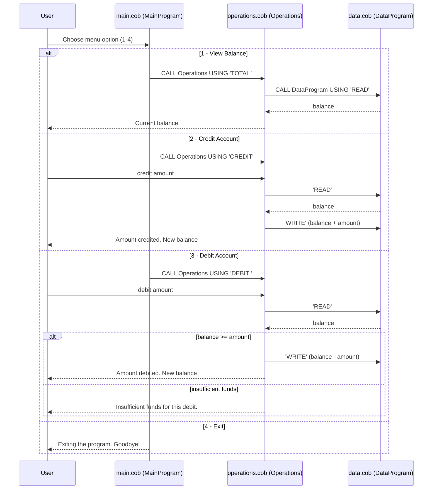

# Legacy COBOL Accounting System

This document explains the COBOL accounting system used by Mergington High School to manage student account balances. The system is a small console application made of three programs.

## Files

### `src/cobol/main.cob` (program `MainProgram`)

The entry point and user interface. It shows a menu in a loop until the user chooses to exit:

1. View Balance
2. Credit Account
3. Debit Account
4. Exit

It reads the user's choice into `USER-CHOICE` and uses `EVALUATE` to call the `Operations` program with a six-character operation code: `'TOTAL '`, `'CREDIT'` or `'DEBIT '`. Any other choice prints "Invalid choice, please select 1-4." Choosing 4 sets `CONTINUE-FLAG` to `'NO'`, which ends the loop and prints a goodbye message.

### `src/cobol/operations.cob` (program `Operations`)

The business logic. It receives the operation code from `main.cob` and does the following:

- **TOTAL**: calls `DataProgram` with `'READ'` and displays the current balance.
- **CREDIT**: asks for an amount, reads the balance, adds the amount, writes the new balance back with `'WRITE'`, and displays the new balance.
- **DEBIT**: asks for an amount and reads the balance. If the balance is greater than or equal to the amount, it subtracts the amount, writes the balance back and displays the new balance. Otherwise it displays "Insufficient funds for this debit." and the balance is unchanged.

### `src/cobol/data.cob` (program `DataProgram`)

The data layer. It holds the balance in `STORAGE-BALANCE` (format `PIC 9(6)V99`, so up to 999999.99, initial value 1000.00). It is called with an operation code and a balance:

- `'READ'` copies the stored balance into the caller's `BALANCE`.
- `'WRITE'` copies the caller's `BALANCE` into the stored balance.

## Business rules

- The starting balance of every session is 1000.00.
- Credits always succeed and add to the balance.
- A debit is rejected if the amount is greater than the balance, so the balance can never go negative.
- Amounts are unsigned with two decimal places and up to six whole digits.
- The balance lives only in memory, so it resets to 1000.00 when the program restarts.

## Data flow

